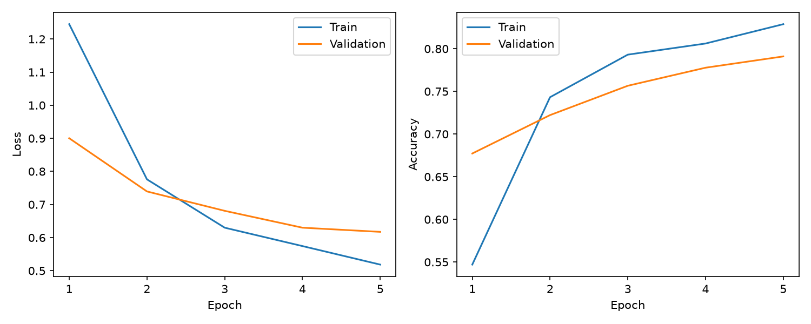
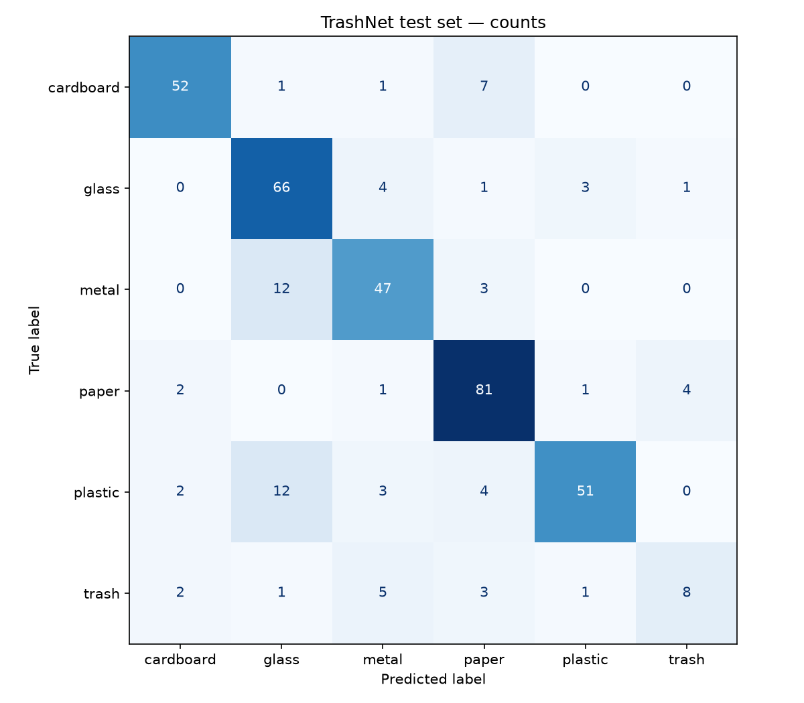
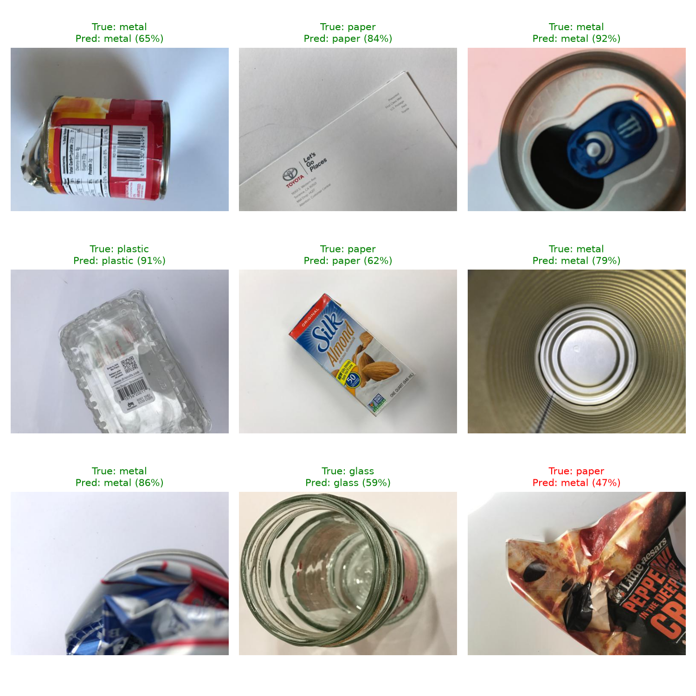

# WasteVision

Waste image classification with pretrained ResNet18 and a small Streamlit interface. This educational project predicts one of six categories: cardboard, glass, metal, paper, plastic, or trash.

## Dataset

[TrashNet](https://github.com/garythung/trashnet), collected by Gary Thung and Mindy Yang, contains 2,527 images: 403 cardboard, 501 glass, 410 metal, 594 paper, 482 plastic, and 137 trash. Images typically show one object against a white background. Use the resized archive from the [official dataset page](https://huggingface.co/datasets/garythung/trashnet/tree/main). Dataset license: MIT; please credit its authors. The dataset is excluded from Git.

### Duplicate cleanup

A SHA-256 scan found three pairs of identical files with conflicting class labels:

- glass/glass115.jpg and metal/metal91.jpg
- glass/glass176.jpg and plastic/plastic152.jpg
- glass/glass389.jpg and plastic/plastic332.jpg

Both copies of each pair are excluded by utils.py before splitting, leaving 2,521 images. Original downloaded files stay unchanged. This avoids ambiguous labels and identical images crossing splits. The scan detects exact file duplicates, not visually similar photos.

## Approach

Image folders → stratified train/validation/test split → preprocessing → transfer learning → evaluation → uploaded-image prediction.

Transfer learning reuses visual features learned on ImageNet, reducing the training needed for a small dataset. We use [torchvision ResNet18](https://docs.pytorch.org/vision/stable/models/generated/torchvision.models.resnet18.html) with its default pretrained weights. The backbone is frozen and its final layer is replaced with a six-output linear layer. Only that layer is trained. Backbone BatchNorm statistics also stay fixed.

- Approximately 70% training, 15% validation, 15% test; stratification preserves class proportions.
- Seed 42; exact relative image paths saved in results/splits.json and the checkpoint.
- Training: resize to 256, random 224×224 crop, horizontal flip, ImageNet normalization.
- Validation/test/app: resize to 256, center crop to 224×224, same normalization.
- Five epochs, batch size 32, Adam learning rate 0.001, cross-entropy loss.
- Save the epoch with highest validation accuracy. The test set does not select the checkpoint.

Cross-entropy trains the classifier from raw outputs. At inference, softmax converts outputs into scores that sum to one. These scores are not calibrated probabilities of correctness.

## Files

- train.py: split creation, training, best checkpoint, and learning curves.
- evaluate.py: held-out test metrics, confusion matrix, sample predictions.
- utils.py: shared model and preprocessing, dataset and checkpoint helpers.
- app.py: image upload, preview, category, confidence, optional top three.
- models/wastevision.pth: generated trained weights, labels, and split metadata.
- results/: generated metrics, split assignments, and figures.

## Run locally

The environment was tested with Python 3.14.4 on Windows using CPU. Direct dependency versions are pinned in requirements.txt. This project uses a local virtual environment; it does not require a GPU.

Windows PowerShell (replace python with python3.14 if that is your installed command):

~~~powershell
python -m venv .venv
.\.venv\Scripts\python.exe -m pip install -r requirements.txt
~~~

Download dataset-resized.zip from the official dataset page above and extract it into data/. The final layout must be:

~~~text
data/dataset-resized/
├── cardboard/
├── glass/
├── metal/
├── paper/
├── plastic/
└── trash/
~~~

Then run:

~~~powershell
.\.venv\Scripts\python.exe train.py
.\.venv\Scripts\python.exe evaluate.py
.\.venv\Scripts\python.exe -m streamlit run app.py
~~~

The first training run downloads ImageNet pretrained weights. Later training runs reuse the saved split. Keep dataset files unchanged. Fixed seeds improve reproducibility; hardware and library differences can still change numerical results.

On macOS/Linux, use .venv/bin/python instead of .\.venv\Scripts\python.exe. Restart Streamlit after retraining so its cached model reloads the new checkpoint.

## Evaluation results

Actual CPU run: five epochs, seed 42, 1,764 training / 378 validation / 379 test images after duplicate cleanup. Epoch 5 had the best validation accuracy (79.10%) and was evaluated on the test set.

**Test accuracy: 80.47%** (305/379 images correct).

| Class | Precision | Recall | F1-score | Test images |
|---|---:|---:|---:|---:|
| cardboard | 89.66% | 85.25% | 87.39% | 61 |
| glass | 71.74% | 88.00% | 79.04% | 75 |
| metal | 77.05% | 75.81% | 76.42% | 62 |
| paper | 81.82% | 91.01% | 86.17% | 89 |
| plastic | 91.07% | 70.83% | 79.69% | 72 |
| trash | 61.54% | 40.00% | 48.48% | 20 |

| Average | Precision | Recall | F1-score |
|---|---:|---:|---:|
| Macro | 78.81% | 75.15% | 76.20% |
| Weighted | 80.99% | 80.47% | 80.14% |

These numbers come from running evaluate.py; full precision is recorded in results/metrics.json and results/classification_report.txt. Accuracy measures overall correctness. Per-class precision measures how often predictions of a class are correct; recall measures how many images of that class are found; F1 balances both. Macro averages weight classes equally; weighted averages reflect their sample counts.

Evaluation also creates results/training_curves.png, results/confusion_matrix.png, and results/sample_predictions.png. Sample images use a fixed random selection, including mistakes if selected.

Trash recall was only 40% (8/20 images), so overall accuracy hides a substantial weakness. The model predicted glass for 12 of 72 plastic images. Cardboard and paper performed better in this particular split. These observations describe this test set, not a guarantee of performance on new photos. No hyperparameter search was performed.

## Limitations

- Small, imbalanced dataset, especially the trash class.
- White-background images may not represent cluttered real-world photos.
- One category per image; no object localization or handling of multiple items.
- Always predicts one of six categories, even for unrelated images.
- A frozen backbone is a simple baseline and may miss waste-specific features.
- These are dataset labels, not advice about local recycling rules.

## What I learned

This project demonstrates how to load labeled image folders, separate training from evaluation, augment training images, reuse pretrained features, replace a classification layer, save and reload weights, interpret class-level metrics, and connect inference to an upload interface. The real run also illustrates why duplicate checks matter: three identical image pairs had conflicting labels. The class report shows why overall accuracy alone is insufficient: 80.47% accuracy coexists with only 40% recall on trash. Use these observations as starting points for your own portfolio discussion.

## Sharing on GitHub

Include code, requirements, README, the trained checkpoint, and generated results. Exclude .venv/, data/, caches, and logs using .gitignore. GitHub publication is a separate step; no remote repository is created by these scripts.

## Verification

Python syntax and dependency checks passed. All 2,527 source images were readable. Saved splits cover the 2,521 retained images with no overlapping paths or exact file hashes. Checkpoint reload and six-class probability outputs were verified. Streamlit AppTest checks passed for an empty upload, an image supplied to the upload handler, the displayed prediction and confidence, the top-three toggle, an invalid image, and a missing checkpoint. These are headless behavior checks; browser appearance was not tested.

## Deploy with Streamlit Community Cloud

1. Publish this repository to GitHub, including models/wastevision.pth and results/. Keep data/, .venv/, and logs excluded.
2. Sign in at https://share.streamlit.io/ and authorize access to the GitHub repository.
3. Select Create app, choose the repository and branch, and set the entrypoint to app.py.
4. In Advanced settings, select Python 3.14 to match the tested local environment, if available.
5. Deploy and check the build logs, then upload test-image.jpg to verify prediction.

The app loads the trained checkpoint; it does not retrain or require the TrashNet dataset. Cloud dependencies are installed from requirements.txt. This deployment has not yet been run or verified. GitHub publication and deployment do not remove local files.
