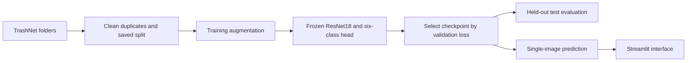
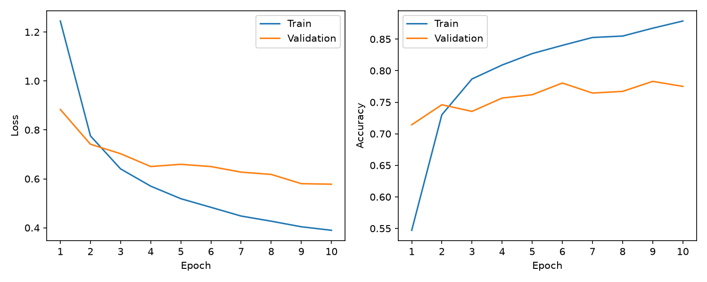
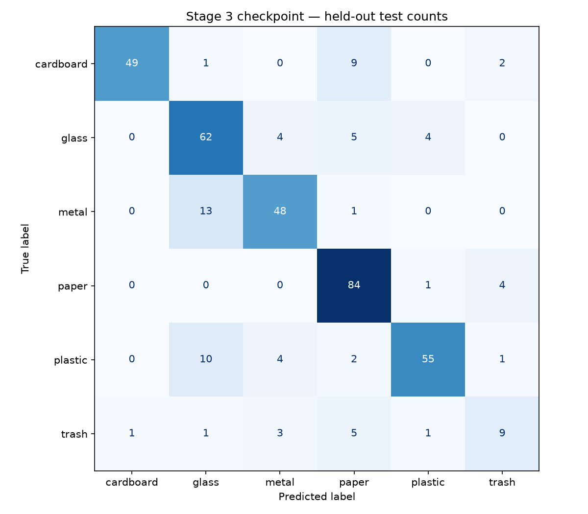
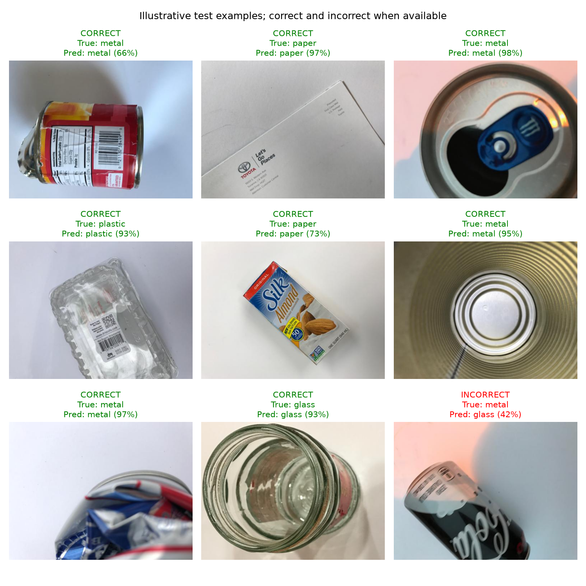
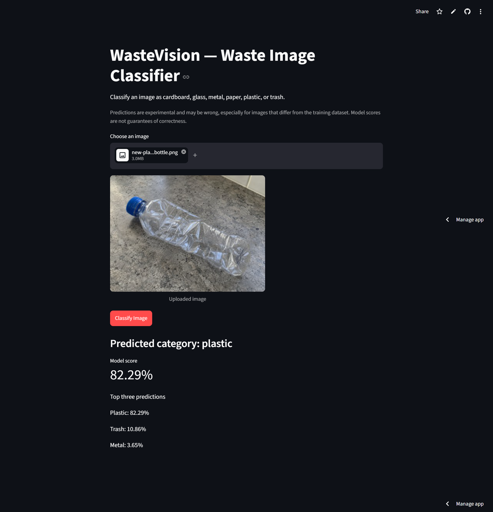

# WasteVision — Waste Image Classification with Deep Learning

A small educational computer vision project that classifies one waste image into **cardboard, glass, metal, paper, plastic, or trash**. It demonstrates dataset preparation, transfer learning with PyTorch, evaluation, and a minimal Streamlit prediction interface.

[Live app](https://samuel-wastevision.streamlit.app/) · [Training curves](#validation) · [Confusion matrix and sample predictions](#held-out-test-set) · [App screenshot](#streamlit-application)

## Problem

WasteVision explores how transfer learning can distinguish common waste materials from photos. The project follows the full image-classification workflow, from preparing labeled data to serving predictions in a simple web app. Its categories describe the dataset and do not determine whether an item is recyclable locally.

## Dataset

[TrashNet](https://github.com/garythung/trashnet), collected by Gary Thung and Mindy Yang, contains **2,527 images**: 403 cardboard, 501 glass, 410 metal, 594 paper, 482 plastic, and 137 trash. Photos were mostly taken against white posterboard, so they do not represent every real-world setting. The upstream repository provides an [MIT license](https://github.com/garythung/trashnet/blob/master/LICENSE); credit its authors when using its images, including the examples and figures here.

Six files in three byte-identical pairs have conflicting labels and are excluded from splitting:

- glass/glass115.jpg and metal/metal91.jpg
- glass/glass176.jpg and plastic/plastic152.jpg
- glass/glass389.jpg and plastic/plastic332.jpg

The remaining **2,521 images** use a stratified split with seed **42**: **1,764 training / 378 validation / 379 test** (approximately 70/15/15). Exact relative paths are preserved in [results/splits.json](results/splits.json). Original images remain unchanged. Exact duplicate checks do not detect all visually similar photos.

See [data/README.md](data/README.md) for download and folder instructions. The dataset is excluded from Git.

## Approach

ResNet18 is a familiar, relatively small CNN available in torchvision. Transfer learning reuses features learned on ImageNet, reducing the training needed for this small dataset. The ImageNet backbone is frozen, including BatchNorm running statistics; the final fully connected layer is replaced with **512 inputs and six output logits**. Only that layer is trained.

- Training: resize to 256, random 224 × 224 crop, horizontal flip, tensor conversion.
- Validation, test, and inference: deterministic resize directly to 224 × 224 and tensor conversion.
- All inputs: ImageNet mean [0.485, 0.456, 0.406] and standard deviation [0.229, 0.224, 0.225].
- Training: 10 epochs, batch size 32, CrossEntropyLoss, Adam on the final layer at learning rate 0.001.
- CPU execution is supported; CUDA is selected when available. No hyperparameter search was performed.

## Results

The included **models/wastevision_stage3.pth** checkpoint was selected by lowest validation loss.

### Validation

Training ran for **10 epochs on CPU**. Epoch **10** had the lowest validation loss (**0.578062**) and validation accuracy of **77.51%**. Final training accuracy was **87.87%**. The gap between training and validation performance suggests limited generalization. Full history is available in [results/history.csv](results/history.csv).

### Held-out test set

The selected model correctly classified **307 of 379 held-out test images**.

| Metric | Test result |
|---|---:|
| Accuracy | 81.00% |
| Macro precision | 79.38% |
| Macro recall | 76.03% |
| Macro F1-score | 77.17% |

| Class | Precision | Recall | F1-score | Test images |
|---|---:|---:|---:|---:|
| cardboard | 98.00% | 80.33% | 88.29% | 61 |
| glass | 71.26% | 82.67% | 76.54% | 75 |
| metal | 81.36% | 77.42% | 79.34% | 62 |
| paper | 79.25% | 94.38% | 86.15% | 89 |
| plastic | 90.16% | 76.39% | 82.71% | 72 |
| trash | 56.25% | 45.00% | 50.00% | 20 |

Accuracy measures overall correctness. Precision measures how often predictions of a class are correct; recall measures how many examples of that class are found. F1 balances precision and recall. Macro averages weight all six classes equally.

The largest directional confusions were metal → glass (13/62), plastic → glass (10/72), and cardboard → paper (9/61). Trash was weakest, with only 9/20 images correctly identified. Overall accuracy hides this class imbalance.

The examples show both correct and incorrect predictions. Full metrics and per-image predictions are in [metrics.json](results/stage4/metrics.json), with a [classification report](results/stage4/classification_report.txt) and [matrix CSV](results/stage4/confusion_matrix.csv).

Evaluation scope: the test split was also used for an earlier baseline. The results above describe the current checkpoint; no tuning followed this evaluation.

## Project structure

~~~text
WasteVision/
├── prepare_data.py              # ImageFolder, split, DataLoaders, examples
├── utils.py                     # ResNet18, preprocessing, checkpoint, inference
├── train.py                     # Training and validation
├── evaluate.py                  # Held-out test evaluation
├── app.py                       # Minimal Streamlit interface
├── requirements.txt
├── README.md
├── .gitignore
├── data/
│   ├── README.md
│   └── dataset-resized/         # Download locally; ignored by Git
├── models/
│   └── wastevision_stage3.pth   # Included trained checkpoint
├── results/
│   ├── splits.json
│   ├── dataset_examples.png
│   ├── history.csv
│   ├── stage3_training_curves.png
│   ├── stage4/                 # Current metrics, matrix, and sample figures
│   ├── streamlit_app.png        # Application screenshot
│   └── ...                     # Preserved earlier baseline artifacts
├── test-image.jpg               # TrashNet cardboard/cardboard37.jpg example
└── new-plastic-bottle.png       # Synthetic demo image
~~~

Root-level evaluation files in results/ are retained from an earlier baseline. Use **results/stage4/** for the current model’s test metrics and figures.

## Installation

Tested with **Python 3.14.4 on Windows, using CPU**. Dependencies are pinned in [requirements.txt](requirements.txt): PyTorch, torchvision, NumPy, matplotlib, scikit-learn, Streamlit, and Pillow.

Run from the repository root in PowerShell:

~~~powershell
python -m venv .venv
.\.venv\Scripts\python.exe -m pip install -r requirements.txt
~~~

On macOS/Linux, use .venv/bin/python in place of .\.venv\Scripts\python.exe.

## Reproduce the workflow

Download and extract TrashNet as described in [the dataset guide](data/README.md), then run:

~~~powershell
.\.venv\Scripts\python.exe prepare_data.py
.\.venv\Scripts\python.exe train.py
.\.venv\Scripts\python.exe evaluate.py
~~~

prepare_data.py loads the dataset with ImageFolder, reuses the saved split, prints counts, and saves labeled examples. train.py downloads pretrained ImageNet weights on its first run, trains only the classification head, and saves the lowest-validation-loss checkpoint. It never evaluates test batches. evaluate.py loads that checkpoint and writes results/stage4/; it does not train or create a new split. Missing checkpoint, split, or dataset files stop evaluation.

**Running training replaces the current checkpoint, history CSV, and training plot. Running evaluation replaces the current Stage 4 outputs.** Preserve any results you want to keep before running these commands. Keep the original dataset and saved split unchanged. Fixed seeds improve reproducibility, but different hardware/library versions can change numerical results.

## Single-image prediction

~~~powershell
.\.venv\Scripts\python.exe utils.py --image test-image.jpg
~~~

~~~python
from utils import predict_image

result = predict_image("test-image.jpg")  # Also accepts a loaded PIL image
print(result["predicted_class"], result["score"])
print(result["top_three"])
~~~

This requires models/wastevision_stage3.pth but does not require the dataset. Labels come from the checkpoint in the saved dataset order. The function uses evaluation mode, disables gradients, and applies softmax to logits. The included test-image.jpg example produces cardboard with a model score of **89.6620%** on the tested CPU environment. Scores are model preferences, not calibrated probabilities of correctness.

## Streamlit application

~~~powershell
.\.venv\Scripts\python.exe -m streamlit run app.py
~~~

Open the local URL printed by Streamlit, normally http://localhost:8501. Upload a JPG, JPEG, or PNG, inspect the preview, then click **Classify Image**. The app displays the category, percentage score, and top three predictions. It calls the same predict_image() function and caches the model resource. Uploaded images stay in memory and are not saved permanently. Restart the app after replacing the checkpoint.

The deployed app classifying a synthetic plastic-bottle image with an **82.29%** model score. This demo image is separate from the TrashNet dataset and is not part of the reported test evaluation.

## Saved checkpoint

The trained checkpoint, [models/wastevision_stage3.pth](models/wastevision_stage3.pth), is included for inference and is **44,872,971 bytes** (about 44.9 MB). A fresh clone can run single-image prediction and Streamlit without retraining or downloading the TrashNet dataset. It contains the epoch-10 model state, class names, saved split, and preprocessing metadata used for the reported results.

The model uses torchvision ResNet18 ImageNet weights and a classification head trained on TrashNet. See the [TrashNet source and license](https://github.com/garythung/trashnet) and [torchvision pretrained-weight guidance](https://docs.pytorch.org/vision/stable/models.html). This repository does not establish a separate license for the upstream pretrained weights.

## Limitations

- Small, imbalanced dataset; only 20 trash images in the test split.
- Plain backgrounds differ from cluttered, poorly lit, or unfamiliar photos.
- One predicted class per image, with no localization or multiple-item handling.
- No unknown or out-of-category detection: a person, animal, car, or other unrelated image still receives one of the six labels, potentially with a high score.
- The trash class is a specific dataset category, not a fallback for unfamiliar images.
- Frozen features may miss waste-specific details; confidence is uncalibrated.
- The training/validation accuracy gap suggests limited generalization.
- Dataset categories do not determine local recycling rules.

## What I learned

- Transfer learning makes a small image-classification experiment practical without training a CNN from scratch.
- Reproducible splits and duplicate checks help keep evaluation meaningful.
- Freezing model parameters also requires attention to BatchNorm running statistics.
- Validation loss and accuracy can favor different epochs, so the checkpoint-selection rule matters.
- Per-class recall and F1 reveal weaknesses that overall accuracy can hide, especially for the minority trash class.
- Shared preprocessing and prediction code keep the model’s behavior consistent between evaluation and the web app.

## Checks

Local checks cover imports, saved splits, checkpoint metadata, metric consistency, and CPU inference. Streamlit headless tests cover classification, caching, and invalid-input handling. GPU execution and fresh installations on other platforms have not been tested.
