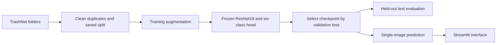

# WasteVision — Waste Image Classification with Deep Learning

A small educational computer vision project that classifies one waste image into **cardboard, glass, metal, paper, plastic, or trash**. It demonstrates dataset preparation, transfer learning with PyTorch, evaluation, and a minimal Streamlit prediction interface.

[Live app](https://samuel-wastevision.streamlit.app/) · [Training curves](#validation) · [Confusion matrix and sample predictions](#held-out-test-set) · [App screenshot](#streamlit-application)

## Problem

Recognizing waste materials is a useful introduction to image classification. WasteVision learns the six TrashNet categories from labeled photos and predicts a category for a new image. It is a learning project, not a recycling decision system or an object detector.

## Dataset

[TrashNet](https://github.com/garythung/trashnet), collected by Gary Thung and Mindy Yang, contains **2,527 images**: 403 cardboard, 501 glass, 410 metal, 594 paper, 482 plastic, and 137 trash. Photos were mostly taken against white posterboard, so they do not represent every real-world setting. The upstream repository provides an [MIT license](https://github.com/garythung/trashnet/blob/master/LICENSE); credit its authors when using its images, including the examples and figures here.

Six files in three byte-identical pairs have conflicting labels and are excluded from splitting:

- glass/glass115.jpg and metal/metal91.jpg
- glass/glass176.jpg and plastic/plastic152.jpg
- glass/glass389.jpg and plastic/plastic332.jpg

The remaining **2,521 images** use a stratified split with seed **42**: **1,764 training / 378 validation / 379 test** (approximately 70/15/15). Exact relative paths are preserved in [results/splits.json](results/splits.json). Original images remain unchanged. Exact duplicate checks do not detect all visually similar photos.

See [data/README.md](data/README.md) for download and folder instructions. The dataset is excluded from Git.

## Approach

ResNet18 is a familiar, relatively small CNN available in torchvision. Transfer learning reuses features learned on ImageNet, reducing the training needed for this small dataset. The ImageNet backbone is frozen, including BatchNorm running statistics; the final fully connected layer is replaced with **512 inputs and six output logits**. Only that layer is trained.

- Training: resize to 256, random 224 × 224 crop, horizontal flip, tensor conversion.
- Validation, test, and inference: deterministic resize directly to 224 × 224 and tensor conversion.
- All inputs: ImageNet mean [0.485, 0.456, 0.406] and standard deviation [0.229, 0.224, 0.225].
- Training: 10 epochs, batch size 32, CrossEntropyLoss, Adam on the final layer at learning rate 0.001.
- CPU execution is supported; CUDA is selected when available. No hyperparameter search was performed.

## Results

These results belong to **models/wastevision_stage3.pth**, selected by lowest validation loss. They are separate from the older baseline artifacts described below.

### Validation

The actual CPU training run completed **10 epochs**. The selected checkpoint was epoch **10**, with validation loss **0.578062** and validation accuracy **77.51%**. The highest validation accuracy was **78.31%** at epoch 9; it was not the selection criterion. Final training accuracy was **87.87%**, which is not test accuracy. History is recorded in [results/history.csv](results/history.csv).

### Held-out test set

The saved evaluation covers all **379 test images exactly once**, with **307 correct**.

| Metric | Test result |
|---|---:|
| Accuracy | 81.00% |
| Macro precision | 79.38% |
| Macro recall | 76.03% |
| Macro F1-score | 77.17% |

| Class | Precision | Recall | F1-score | Test images |
|---|---:|---:|---:|---:|
| cardboard | 98.00% | 80.33% | 88.29% | 61 |
| glass | 71.26% | 82.67% | 76.54% | 75 |
| metal | 81.36% | 77.42% | 79.34% | 62 |
| paper | 79.25% | 94.38% | 86.15% | 89 |
| plastic | 90.16% | 76.39% | 82.71% | 72 |
| trash | 56.25% | 45.00% | 50.00% | 20 |

Accuracy measures overall correctness. Precision measures how often predictions of a class are correct; recall measures how many examples of that class are found. F1 balances precision and recall. Macro averages weight all six classes equally.

The largest directional confusions were metal → glass (13/62), plastic → glass (10/72), and cardboard → paper (9/61). Trash was weakest, with only 9/20 images correctly identified. Overall accuracy hides this class imbalance.

The sample figure includes a success and an error when available; it is illustrative rather than an accuracy estimate. Exact values and per-image predictions are in [metrics.json](results/stage4/metrics.json), with a [classification report](results/stage4/classification_report.txt) and [matrix CSV](results/stage4/confusion_matrix.csv).

The same test split had already been used for an earlier baseline, so this is not its first-ever evaluation. No model tuning was performed after inspecting the current results.

## Project structure

~~~text
WasteVision/
├── prepare_data.py              # ImageFolder, split, DataLoaders, examples
├── utils.py                     # ResNet18, preprocessing, checkpoint, inference
├── train.py                     # Training and validation
├── evaluate.py                  # Held-out test evaluation
├── app.py                       # Minimal Streamlit interface
├── requirements.txt
├── README.md
├── .gitignore
├── data/
│   ├── README.md
│   └── dataset-resized/         # Download locally; ignored by Git
├── models/
│   ├── wastevision_stage3.pth   # Included trained checkpoint
│   └── wastevision.pth          # Earlier local baseline; not used by current app
├── results/
│   ├── splits.json
│   ├── dataset_examples.png
│   ├── history.csv
│   ├── stage3_training_curves.png
│   ├── stage4/                 # Current metrics, matrix, and sample figures
│   └── ...                     # Preserved earlier baseline artifacts
└── test-image.jpg               # TrashNet cardboard/cardboard37.jpg example
~~~

The older models/wastevision.pth and root-level results/metrics.json, classification_report.txt, history.json, training_curves.png, confusion_matrix.png, and sample_predictions.png are preserved historical baseline artifacts. Their 80.47% test accuracy and center-crop preprocessing do not describe the current model. Current code uses results/stage4/ and direct 224 × 224 evaluation resizing.

## Installation

Tested locally on **Windows with Python 3.14.4 and CPU**. Dependencies are pinned in [requirements.txt](requirements.txt): PyTorch, torchvision, NumPy, matplotlib, scikit-learn, Streamlit, and Pillow. Other Python/OS combinations have not been verified.

Run from the repository root in PowerShell:

~~~powershell
python -m venv .venv
.\.venv\Scripts\python.exe -m pip install -r requirements.txt
~~~

On macOS/Linux, use .venv/bin/python in place of .\.venv\Scripts\python.exe; that environment has not been tested here.

## Reproduce the workflow

Download and extract TrashNet as described in [the dataset guide](data/README.md), then run:

~~~powershell
.\.venv\Scripts\python.exe prepare_data.py
.\.venv\Scripts\python.exe train.py
.\.venv\Scripts\python.exe evaluate.py
~~~

prepare_data.py loads the dataset with ImageFolder, reuses the saved split, prints counts, and saves labeled examples. train.py downloads pretrained ImageNet weights on its first run, trains only the classification head, and saves the lowest-validation-loss checkpoint. It never evaluates test batches. evaluate.py loads that checkpoint and writes results/stage4/; it does not train or create a new split. Missing checkpoint, split, or dataset files stop evaluation.

**Running training replaces the current checkpoint, history CSV, and training plot. Running evaluation replaces the current Stage 4 outputs.** Preserve any results you want to keep before running these commands. Keep the original dataset and saved split unchanged. Fixed seeds improve reproducibility, but different hardware/library versions can change numerical results.

## Single-image prediction

~~~powershell
.\.venv\Scripts\python.exe utils.py --image test-image.jpg
~~~

~~~python
from utils import predict_image

result = predict_image("test-image.jpg")  # Also accepts a loaded PIL image
print(result["predicted_class"], result["score"])
print(result["top_three"])
~~~

This requires models/wastevision_stage3.pth but does not require the dataset. Labels come from the checkpoint in the saved dataset order. The function uses evaluation mode, disables gradients, and applies softmax to logits. A real CPU run on test-image.jpg predicted cardboard with score **89.6620%**; top alternatives were paper **10.2807%** and trash **0.0281%**. Scores are model preferences, not calibrated probabilities of correctness.

## Streamlit application

~~~powershell
.\.venv\Scripts\python.exe -m streamlit run app.py
~~~

Open the local URL printed by Streamlit, normally http://localhost:8501. Upload a JPG, JPEG, or PNG, inspect the preview, then click **Classify Image**. The app displays the category, percentage score, and top three predictions. It calls the same predict_image() function and caches the model resource. Uploaded images stay in memory and are not saved permanently. Restart the app after replacing the checkpoint.

User-provided screenshot of the deployed app. The input is the AI-generated new-plastic-bottle.png example, separate from the TrashNet splits. The displayed prediction is plastic (82.29%), with trash (10.86%) and metal (3.65%) as alternatives. This illustrates one successful prediction; it does not establish real-world accuracy.

## Saved checkpoint

The trained checkpoint, [models/wastevision_stage3.pth](models/wastevision_stage3.pth), is included for inference and is **44,872,971 bytes** (about 44.9 MB). A fresh clone can run single-image prediction and Streamlit without retraining or downloading the TrashNet dataset. It contains the epoch-10 model state, class names, saved split, and preprocessing metadata used for the reported results.

The older baseline checkpoint remains excluded from the current revision and is retained locally. Historical commits may still contain it. Only the current Stage 3 checkpoint is allowed by the model-file ignore rules.

The model uses torchvision ResNet18 ImageNet weights and a classification head trained on TrashNet. See the [TrashNet source and license](https://github.com/garythung/trashnet) and [torchvision pretrained-weight guidance](https://docs.pytorch.org/vision/stable/models.html). This repository does not establish a separate license for the upstream pretrained weights.

## Limitations

- Small, imbalanced dataset; only 20 trash images in the test split.
- Plain backgrounds differ from cluttered, poorly lit, or unfamiliar photos.
- One predicted class per image, with no localization or multiple-item handling.
- No unknown or out-of-category detection: a person, animal, car, or other unrelated image still receives one of the six labels, potentially with a high score.
- The trash class is a specific dataset category, not a fallback for unfamiliar images.
- Frozen features may miss waste-specific details; confidence is uncalibrated.
- The training/validation accuracy gap suggests limited generalization.
- Dataset categories do not determine local recycling rules.

## What I learned

This workflow demonstrates labeled folder loading, reproducible splitting, training-only augmentation, transfer learning, freezing BatchNorm statistics, and saving a checkpoint by validation loss. Per-class metrics show why accuracy alone is insufficient. Sharing preprocessing and inference code keeps evaluation and the upload interface consistent. Exact duplicate checks also exposed ambiguous dataset labels that could otherwise cross splits.

## Verification

The final audit checked Python syntax and imports, actual dataset counts and saved split, checkpoint class ordering and six-output head, frozen/trainable parameters, and the selected checkpoint against the minimum validation loss in the CSV. Saved per-image test predictions reproduced the classification report and confusion matrix without rerunning test inference. Single-image CPU prediction passed.

Stage 6 headless AppTest checks covered empty input, real image bytes supplied to the upload handler, preview, classification button, displayed prediction/top three, model caching, invalid upload, and simulated missing-checkpoint/inference failures. Local server startup was checked again during the final audit. The user supplied a screenshot showing successful deployed inference on the synthetic plastic-bottle example. Independent browser interaction, screen resizing, CUDA, and fresh installation were not tested. No training was performed for this audit.
